> 🏕️ 专为闲鱼平台打造的AI值守解决方案，实现闲鱼平台7×24小时自动化值守，支持多专家协同决策、智能议价和上下文感知对话。

## 实际效果展示

## 设置代理IP

电商类的平台一般都会有风控，需要避免跨区域登陆。所以建议使用前先接入一个IP代理。

🔗 [快代理 - 企业级HTTP代理IP云服务](https://www.kuaidaili.com/?ref=686h4aeuduls)

推荐使用快代理，购买自己常用地点的固定IP地址。

比如我的设备都放在杭州
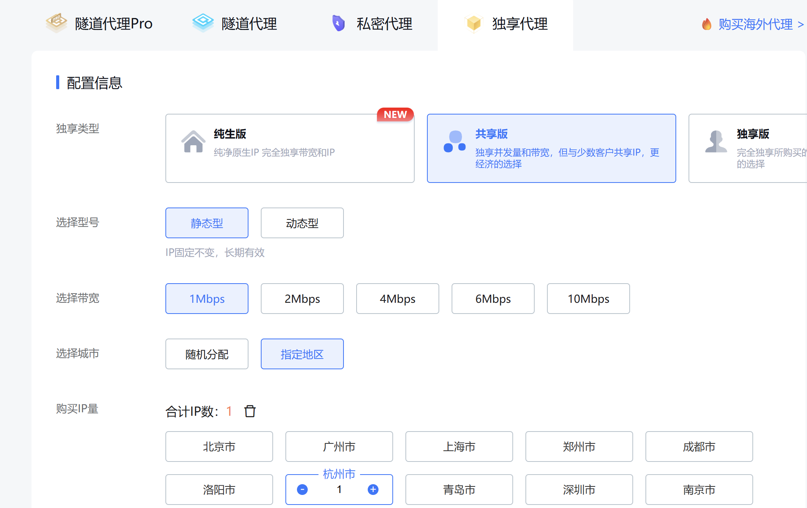
购买完成后，进入我的独享代理，复制IP地址、端口、秘钥，填写到XianyuFlip后台
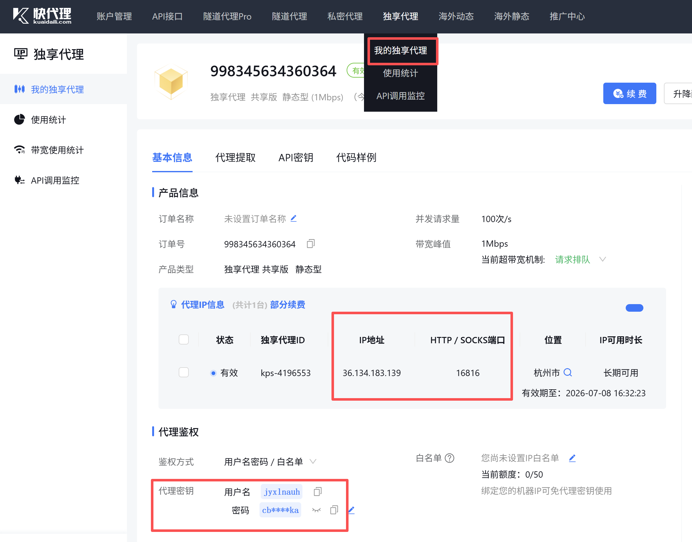
点击检测，显示连接正常，即可使用
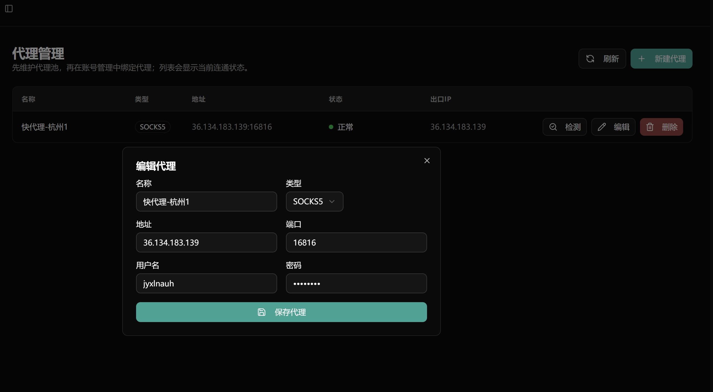
> ⚠️ 如果触发了风控，需要在浏览器登录闲鱼，手动过滑块并填写新的Cookie。当前版本正常使用还是比较稳定的。

## 登陆闲鱼账号

账号管理中已经支持扫码登陆，建议直接采用扫码登陆即可。
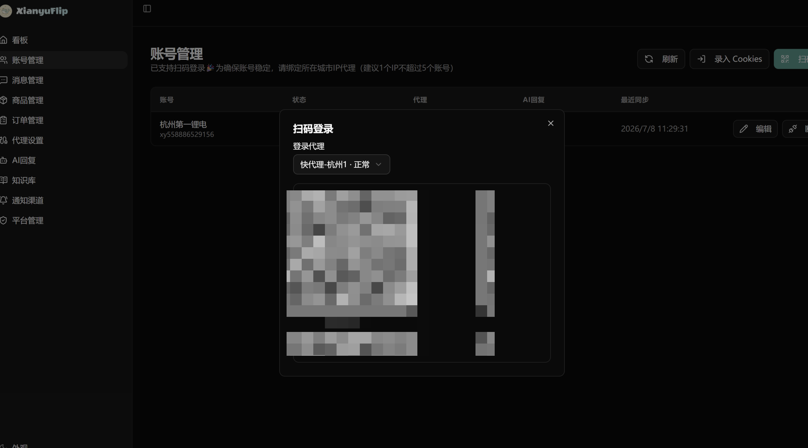
要开启自动回复，还需要绑定一个AI回复方案。请参考下一节设置

## 设置AI回复

### 大模型设置

推荐使用小米MIMO、DEEPSEEK，便宜效果好。

- 🔗 [小米MIMO](https://platform.xiaomimimo.com?ref=NBX3JZ)
- 🔗 [DeepSeek Platform](https://platform.deepseek.com/usage)

完成模型的充值购买后，在大模型后台创建一个APIkey
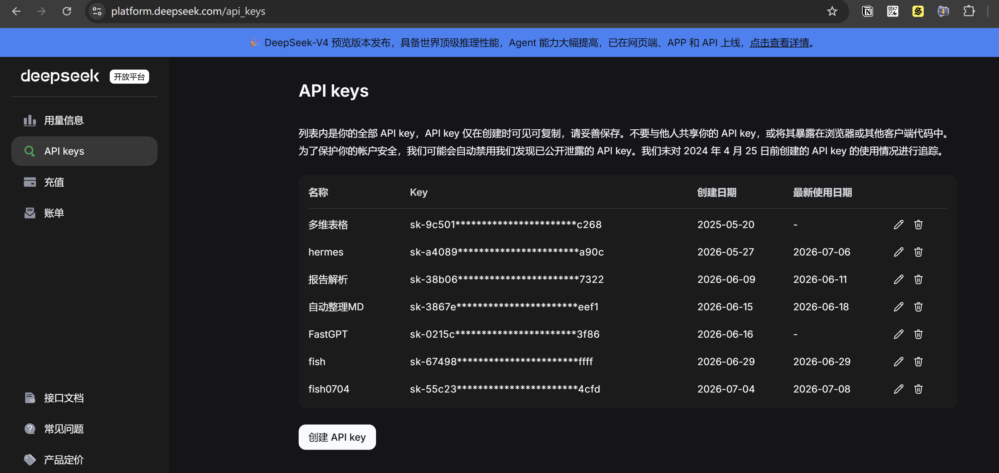
填写基础URL和APIkey到XianyuFlip后台
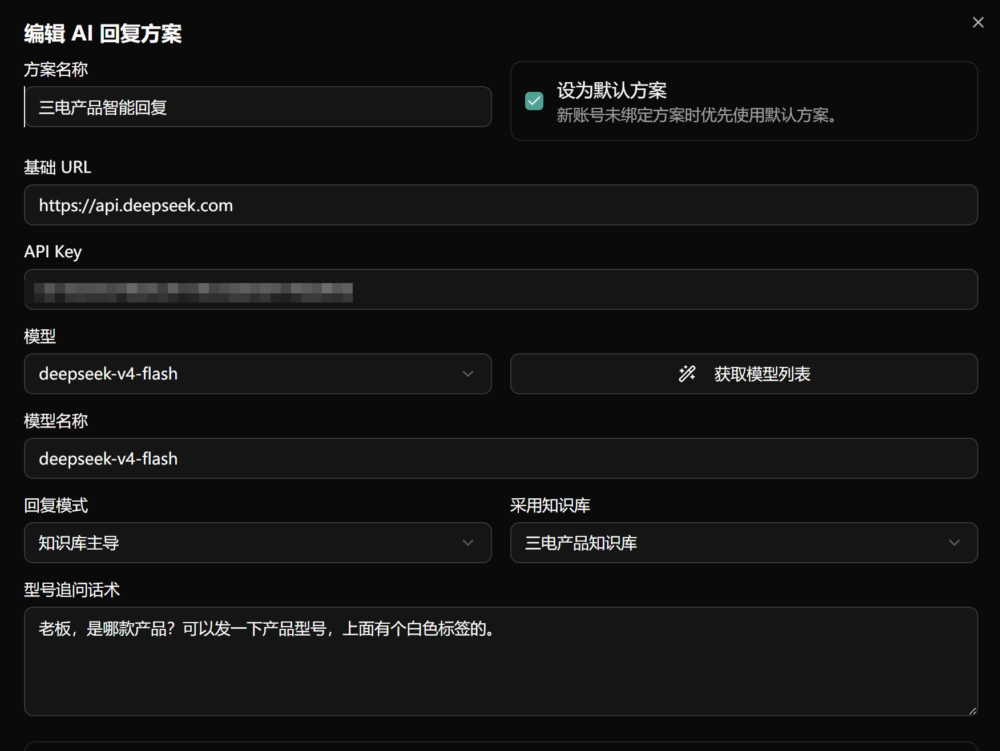
```
deepseek：https://api.deepseek.com
XiaomiMIMO：https://api.xiaomimimo.com/v1
```

填写后点击获取模型列表即可获取该服务商的全部模型，选取合适的使用即可。

### 帖子主导/知识库主导

**帖子主导：** 大模型会基于商品帖子中的内容以及标价和用户沟通；

**知识库主导：** 根据用户发送的消息（以及图片）中的型号等关键词，先匹配知识库中的商品，以知识库中的信息为准。

常规业务，帖子可以覆盖产品信息和报价，设置帖子主导即可；复杂实物交易，如充电机等，可以采用知识库主导。

### AI回复逻辑

- **意图分类提示词**：判断用户当前的对话意图，分配给以下专家进行具体对话
- **价格专家提示词**
- **技术专家提示词**
- **默认回复提示词**

提示词均可根据需求自行修改，优质提示词可以参考下方 [提示词参考](#提示词参考) 章节。

### 响应图片消息

如果业务场景中用户经常通过图片来提供产品型号，可以打开 `支持图形识别` 按钮

（注意图片上需要带型号的文字，本质是文字识别）

## 产品知识库

### 模版知识库

如果你的产品满足以下情况：

- 报价逻辑比较复杂
- 涉及多sku、多品相
- 客户来咨询的时候，并不会按照帖子里面的内容来咨询

建议开启知识库功能，目前只支持**飞书多维表格**作为知识库。
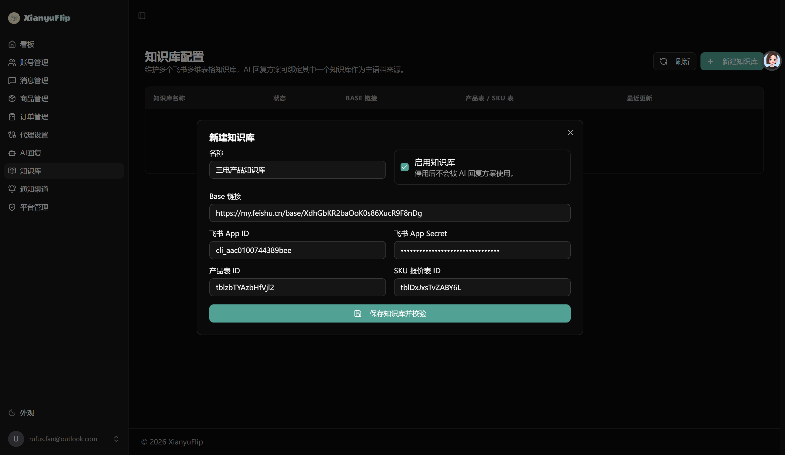
目前已经提供三电知识库，可以直接使用[新能源汽配知识库](https://my.feishu.cn/base/XdhGbKR2baOoK0s86XucR9F8nDg?from=from_copylink)

```
名称：任意填写
BaseURL：https://my.feishu.cn/base/XdhGbKR2baOoK0s86XucR9F8nDg
APP ID：cli_aac0100744389bee
APP secret：eu0jPSscMpFgcpD6y9zs4nn7SJ00nLtr
产品表ID：tblzbTYAzbHfVjl2
SKU报价表ID：tblDxJxsTvZABY6L
```

### 创建自己的知识库

可以参考知识库案例来制作自己的知识库。

在飞书开放平台创建应用，添加多维表格读写权限，然后复制APP ID和APP secret。
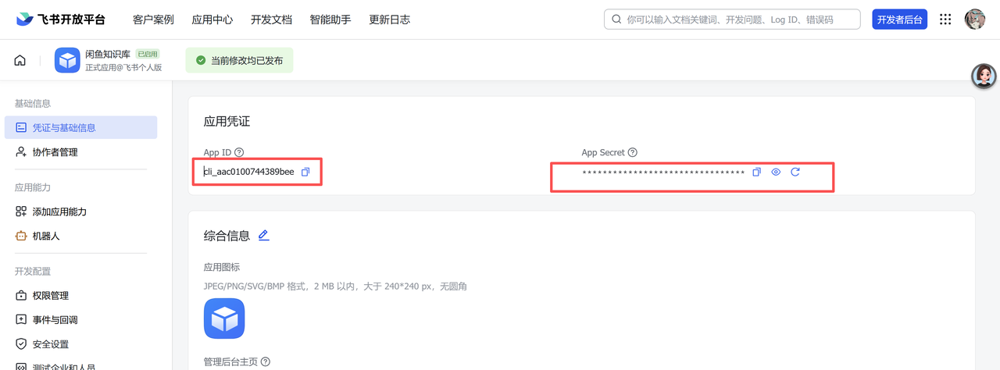
根据模板创建自己的多维表格，然后复制BaseURL和两张表格的ID。
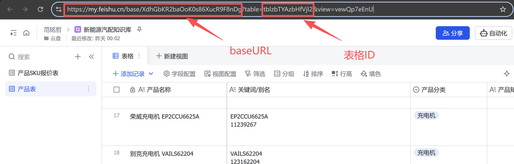
在XianyuFlip后台填写，保存后即可生效。
## 消息通知

当发生异常情况，用户下单、退款的时候，都会通过飞书去进行消息提醒。

两步即可实现：

1. 创建一个飞书群聊并在里面添加一个机器人
2. 把机器人的webhook填写到XianyuFlip后台
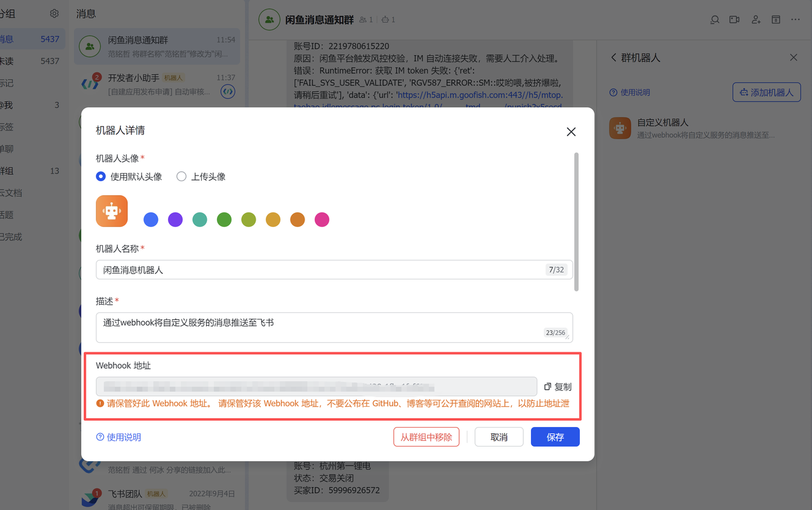
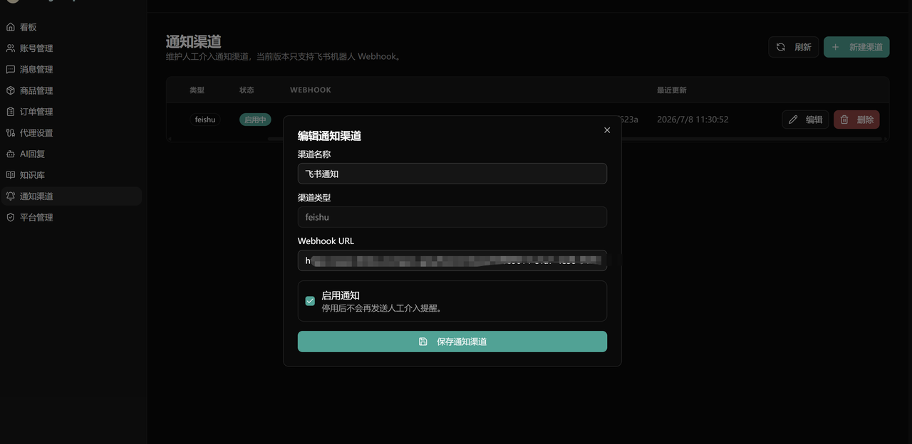
## 提示词参考

> 🏖️ 这里收集适合各行各业的提示词，欢迎大家贡献

- [三电提示词](https://my.feishu.cn/wiki/AOoDwKFSuiFRdyk5TvscEDj7nWe?from=from_copylink)